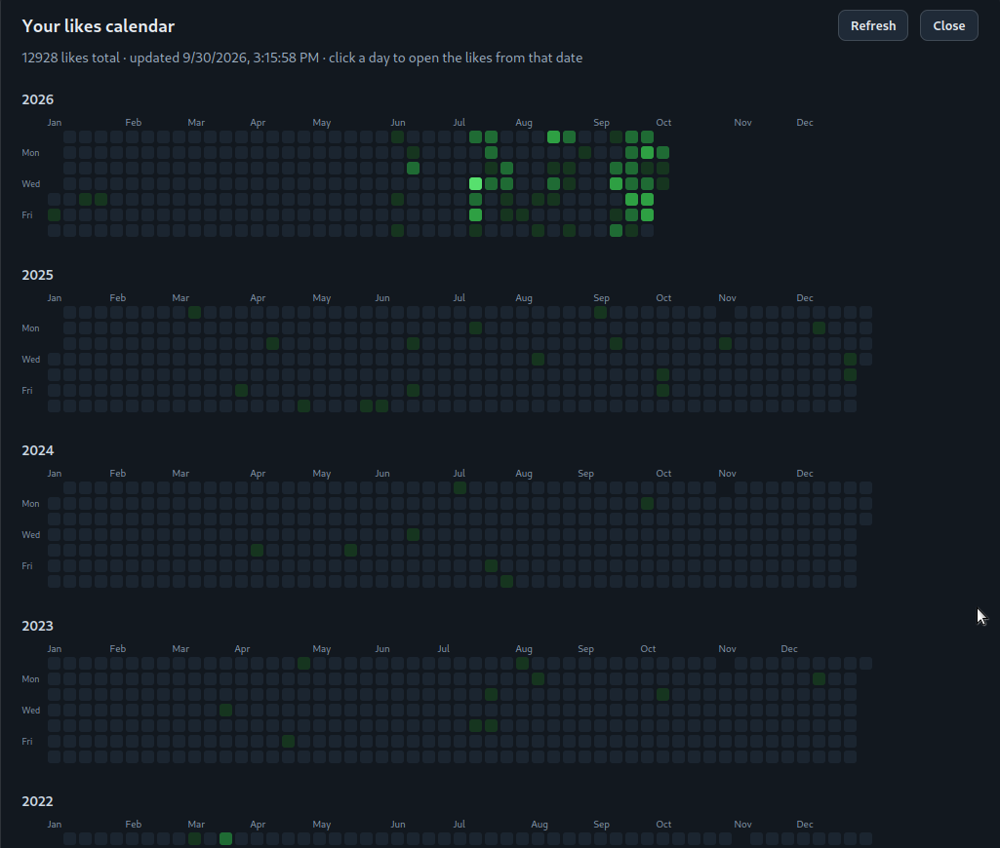

Tumblr Likes Calendar

Browser extension for Firefox and Chrome that adds a heatmap calendar of your "likes" to the Tumblr Likes page (tumblr.com/likes): each day is shaded based on how many posts you liked, and clicking a day shows the likes from that date right in the panel.

Tumblr's likes can't be searched or filtered, so finding an image you saved months ago means scrolling endlessly. This extension turns your likes into something you can actually navigate by date, tag and blog.

  
  &nbsp;&nbsp;
  

📦 Available on Firefox Add-ons: https://addons.mozilla.org/firefox/addon/tumblr-likes-calendar/

📦 Available on Chrome Web Store: https://chromewebstore.google.com/detail/tumblr-likes-calendar/dhpphdeacendokgoaceccnghjjeineld

Features

Heatmap calendar of your likes, one panel per year.
Click a day → the likes from that day are listed in the panel, without leaving the page.
Per-day like count on hover.
Tag search: type a tag (or click one of your most-used tags) to list every like carrying it.
Blog search: type blog:name, or click a blog name in any result, to list every like from that blog.
Gallery of your liked images: a virtualized thumbnail grid that stays fast even with tens of thousands of likes, with an in-place filter by tag or blog:name and a year/month rail to jump straight to any period.
Followed blogs tab: indexes the original image posts of the blogs you follow and lets you search them by tag. The download is manual, can cover all blogs or only the ones you pick, and resumes where it stopped.
Fast: your data is cached locally after the first scan.
Privacy

Everything stays on your computer. The extension reads your data through Tumblr's own in-page helper (window.tumblr.apiFetch, no API key needed) and stores your likes (tags, image links, blog, permalink) and the posts downloaded from the blogs you follow only locally, in your browser's IndexedDB. No data is ever sent anywhere. Note that the followed-blogs index can take up hundreds of MB if you download many blogs.

How it works

The content script runs in the page's main world so it can use window.tumblr.apiFetch, the authenticated helper Tumblr exposes to extensions. It pages through your likes via the API, reads each like's timestamp (likedTimestamp), and groups them by day. Each like is stored in IndexedDB, so subsequent openings are instant and searches by date, tag or blog run locally without calling Tumblr again.

Installation

The easiest way is to install from the Chrome Web Store or Firefox Add-ons (links above). For Firefox, each GitHub release also includes the signed .xpi file, which you can install directly by opening it in Firefox.

From source, for testing:
Open Firefox at about:debugging#/runtime/this-firefox.
Click Load Temporary Add-on….
Select the manifest.json file from this repository.
Go to https://www.tumblr.com/likes: a 📅 Likes calendar button appears at the bottom-right. Click it, then press Refresh on first run.
Notes and limitations
The first scan can take a while if you have many likes.
The calendar shows when you liked a post, not when it was published.
The number of retrievable likes may be slightly lower than Tumblr's counter: likes on deleted posts or blogs are no longer returned by the API (and are no longer reachable anyway).
Requirements

Firefox 128 or later, or Chrome 111 or later.

Found a bug?

Please open an issue on GitHub: https://github.com/Amicolinux/tumblr-likes-calendar/issues — or write to amicolinux@gmx.us. Mention your browser and version, the extension version, and what you did before the problem appeared.

Contributing

Bug reports and suggestions are welcome via Issues. For changes, feel free to open a Pull Request.

License

Released under the GNU General Public License v3.0 (GPLv3). See the LICENSE file. Anyone distributing modified versions must keep them open source under the same license.
